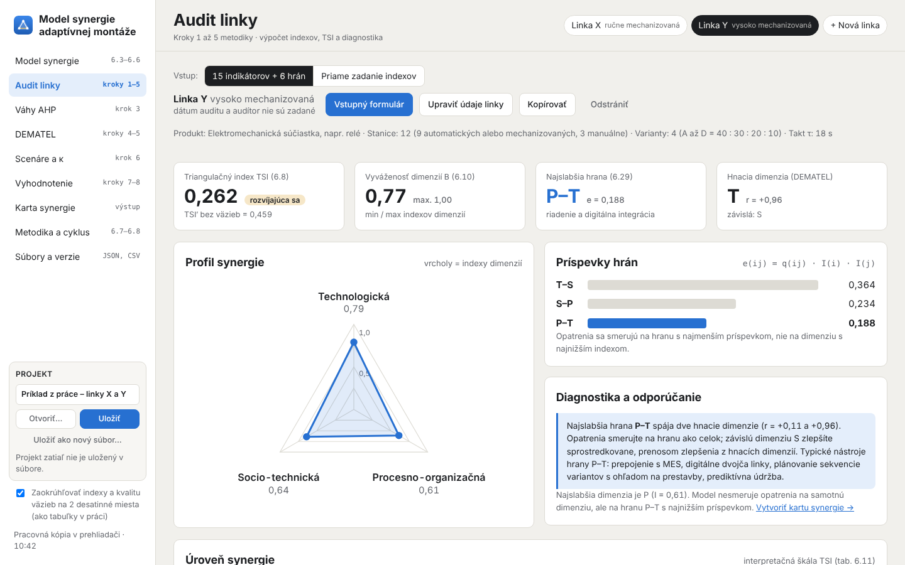
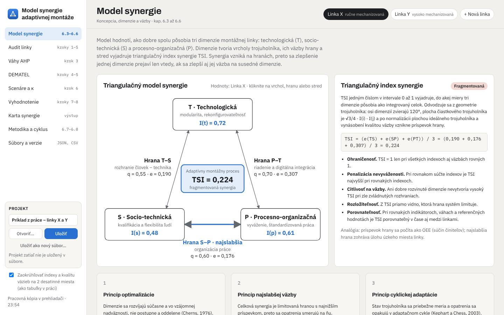
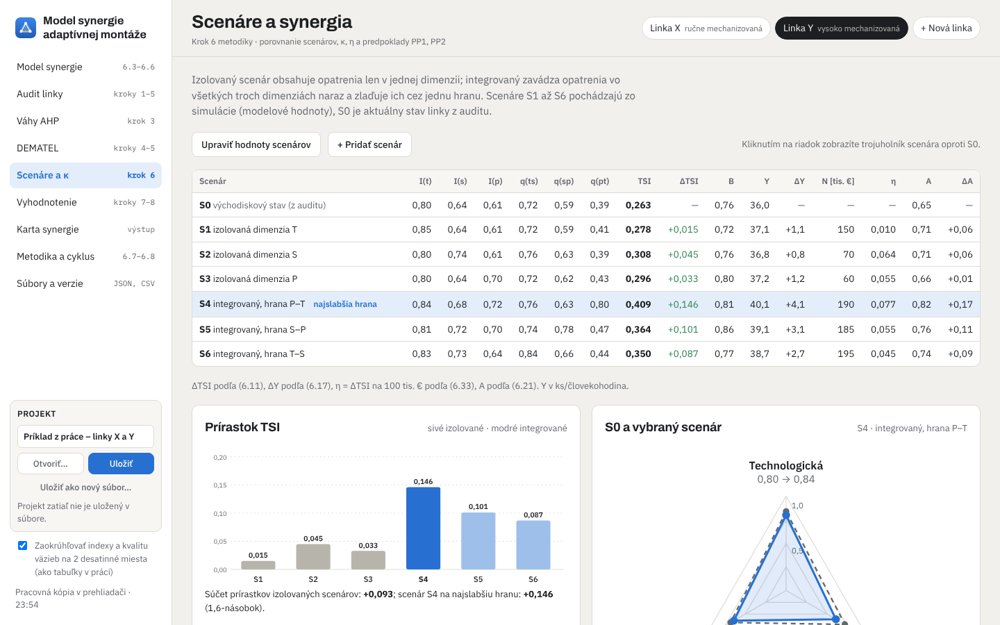
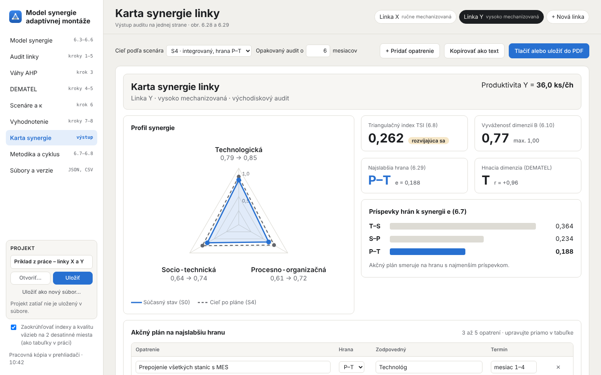
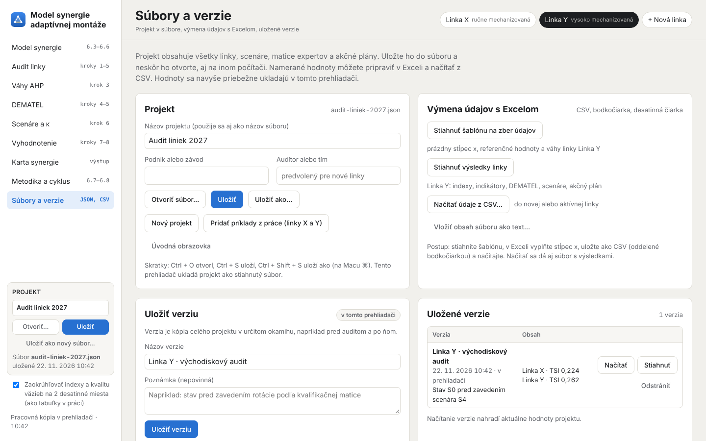
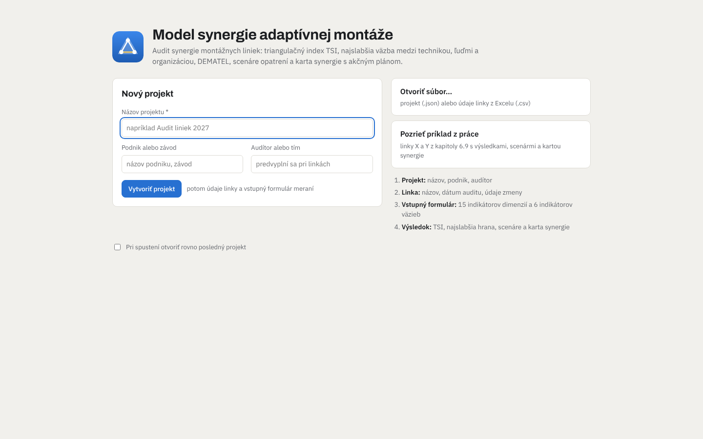
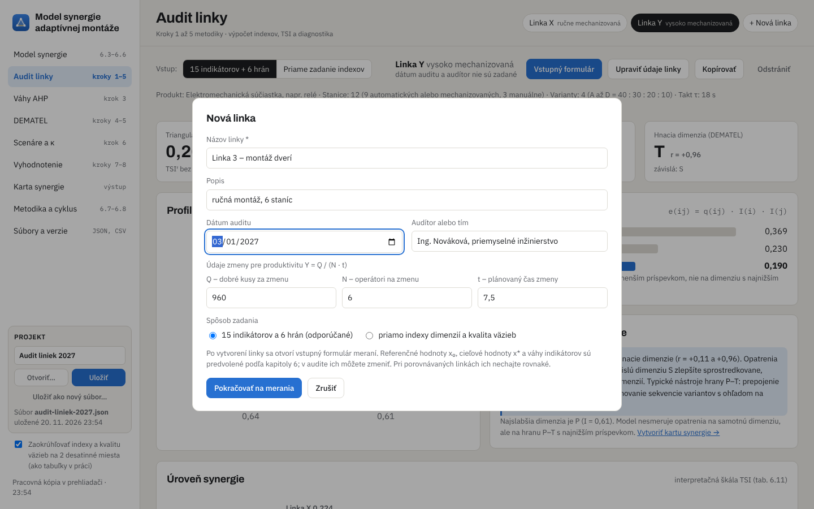
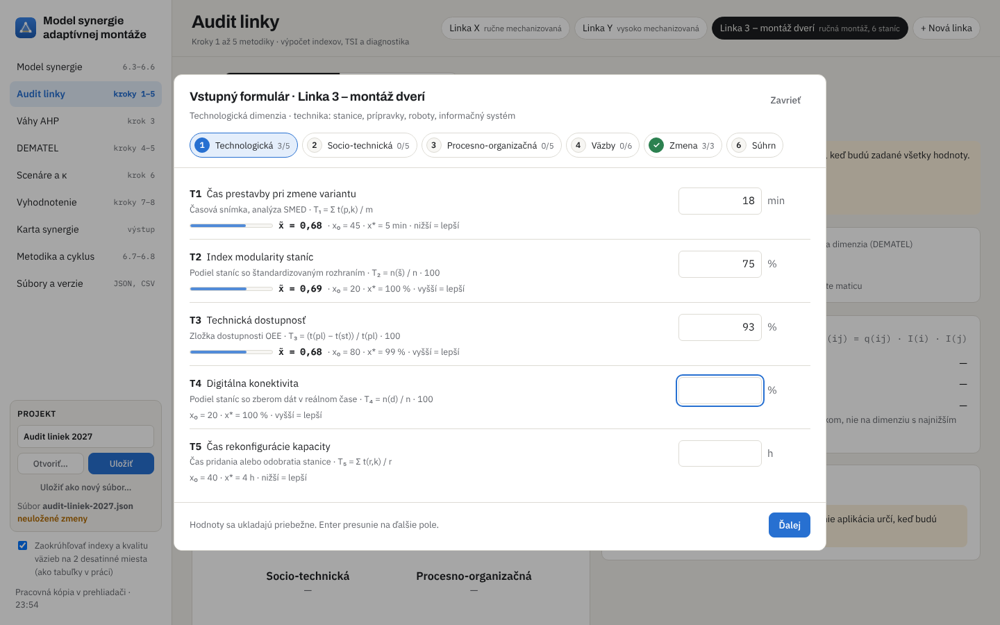
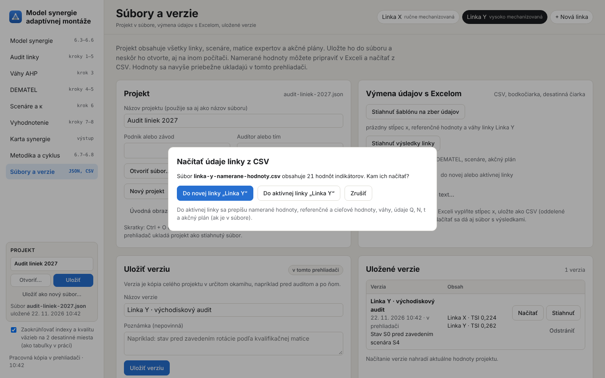

# Model synergie adaptívnej montáže

**[▶ Spustiť aplikáciu](https://miro1heglas-gif.github.io/Model-synergie/)** · https://miro1heglas-gif.github.io/Model-synergie/

Aplikácia na audit synergie montážnych liniek podľa modelu organizácie a synergie adaptívnych montážnych procesov z kapitoly 6 habilitačnej práce *Organizácia a synergia adaptívnych montážnych procesov* (V. Biňasová, Žilinská univerzita v Žiline, 2027). Vypočíta triangulačný index synergie TSI linky, určí najslabšiu väzbu medzi technikou, ľuďmi a organizáciou, porovná scenáre opatrení a pripraví kartu synergie s akčným plánom.

Projekt s ľubovoľným počtom liniek sa ukladá do súboru a znova otvára. Namerané hodnoty sa dajú pripraviť v Exceli a načítať z CSV. Celá aplikácia je jeden HTML súbor bez závislostí a bez servera; údaje neopúšťajú počítač používateľa.



## Čo aplikácia robí

| Sekcia | Krok metodiky | Čo v nej urobíte |
| --- | --- | --- |
| Model synergie | kap. 6.3 až 6.6 | Preskúmate trojuholník T–S–P, obsah väzieb a vlastnosti TSI; vyskúšate penalizáciu nevyváženosti (tab. 6.12). |
| Audit linky | kroky 1 až 5 | Zadáte 15 indikátorov dimenzií a 6 indikátorov hrán (alebo priamo indexy). Aplikácia normalizuje hodnoty, vypočíta indexy I(t), I(s), I(p), kvalitu väzieb, príspevky hrán, TSI, vyváženosť B, index adaptability A a produktivitu Y a určí najslabšiu hranu. |
| Váhy AHP | krok 3 | Párové porovnanie indikátorov na Saatyho škále, váhy z vlastného vektora, kontrola CR ≤ 0,10, zápis váh do auditu. |
| DEMATEL | kroky 4 a 5 | Matice expertov, priemerná matica, celkové vplyvy, hnacie a závislé dimenzie, príčinný diagram a kontrola robustnosti pri vynechaní experta. |
| Scenáre a κ | krok 6 | Porovnanie izolovaných a integrovaných scenárov (ΔTSI, B, A, η), koeficient synergie κ a vyhodnotenie predpokladov PP1 a PP2. |
| Vyhodnotenie | kroky 7 a 8 | Validácia simulácie δ ≤ 5 %, Welchov t-test a bootstrapový interval spoľahlivosti κ. |
| Karta synergie | výstup | Karta linky na jednej strane s akčným plánom; tlač alebo uloženie do PDF, kopírovanie ako text. |
| Metodika a cyklus | kap. 6.7 a 6.8 | Osem krokov metodiky, adaptačný cyklus MAPE-K, riadiace úrovne a priebeh auditu. |
| Súbory a verzie | projekt | Otvorenie a uloženie projektu, nový projekt, šablóna CSV na zber údajov, načítanie CSV, výsledky do Excelu, pomenované verzie. |

| Model synergie | Scenáre a κ |
| --- | --- |
|  |  |
| **Karta synergie** | **Súbory a verzie** |
|  |  |

## Rýchly štart

- **Bez inštalácie:** otvorte `docs/index.html` v prehliadači.
- **Lokálny server:** `npm run serve` a potom http://localhost:8080 (potrebuje Python 3).
- **Online:** [https://miro1heglas-gif.github.io/Model-synergie/](https://miro1heglas-gif.github.io/Model-synergie/) (po zapnutí GitHub Pages, pozri nižšie). V Chrome a Edge sa dá stránka nainštalovať ako aplikácia s vlastnou ikonou (ikona inštalácie v adresnom riadku).

Pri spustení sa zobrazí úvodná obrazovka: **Nový projekt**, **Pokračovať** v rozpracovanom projekte, **Otvoriť súbor** alebo **Pozrieť príklad z práce** (linky X a Y z kapitoly 6.9). Ak ju nechcete vidieť pri každom spustení, zaškrtnite *Pri spustení otvoriť rovno posledný projekt*; znova ju otvorí klik na logo v bočnom paneli.



Vlastný audit prebieha v štyroch krokoch:

1. **Projekt:** názov, podnik alebo závod, audítor alebo tím (predvyplní sa pri linkách).
2. **Linka:** názov, popis, dátum auditu, audítor, údaje zmeny Q, N, t a spôsob zadania (15 indikátorov a 6 hrán alebo priamo indexy). Ďalšie linky pridáte tlačidlom **+ Nová linka**, neskôr ich upravíte tlačidlom **Upraviť údaje linky**.
3. **Vstupný formulár meraní** po krokoch: technologická, socio-technická a procesno-organizačná dimenzia (po 5 indikátoroch), väzby (6 indikátorov), produktivita zmeny a súhrn. Pri každom poli je metóda merania, vzorec, referenčná a cieľová hodnota a hneď vypočítaná normalizovaná hodnota x̃; hodnoty mimo rozsahu a percentá mimo 0 až 100 sú označené. Enter presunie na ďalšie pole, hodnoty sa ukladajú priebežne. Formulár otvoríte kedykoľvek tlačidlom **Vstupný formulár** v Audite linky.
4. **Výsledok:** TSI, vyváženosť B, najslabšia hrana, profil synergie; ďalej DEMATEL, scenáre a karta synergie.

Kým nie sú zadané všetky hodnoty, aplikácia ukáže, ktoré chýbajú, a TSI ani diagnostiku nepočíta.





## Práca so súbormi

### Projekt (.json)

Projekt obsahuje všetky linky, váhy AHP, matice expertov DEMATEL, scenáre, údaje na vyhodnotenie a akčné plány.

| Akcia | Kde | Skratka |
| --- | --- | --- |
| Otvoriť projekt | bočný panel alebo Súbory a verzie | Ctrl + O |
| Uložiť | bočný panel alebo Súbory a verzie | Ctrl + S |
| Uložiť ako nový súbor | bočný panel alebo Súbory a verzie | Ctrl + Shift + S |
| Nový projekt, pridať príklady z práce | Súbory a verzie | |

V Chrome a Edge sa projekt ukladá späť do otvoreného súboru (File System Access API). V ostatných prehliadačoch a pri vložení do iného webu sa uloží ako stiahnutý súbor s názvom projektu. Bočný panel ukazuje názov súboru a upozorní na neuložené zmeny; pri zatvorení stránky s neuloženými zmenami sa prehliadač opýta.

### Výmena údajov s Excelom (.csv)

1. **Stiahnuť šablónu na zber údajov**: CSV s prázdnym stĺpcom *x*, referenčnými hodnotami *x0*, cieľovými hodnotami *x\** a váhami *w* aktívnej linky, s riadkami pre dátum auditu, audítora, Q, N, t a akčný plán.
2. V Exceli vyplňte stĺpec *x* (prípadne Q, N a opatrenia) a uložte ako **CSV (oddelené bodkočiarkou)**.
3. **Načítať údaje z CSV** a zvoľte, či vznikne nová linka, alebo sa prepíšu hodnoty aktívnej linky.

Aplikácia rozpozná oddeľovač (bodkočiarka alebo čiarka), desatinnú čiarku aj bodku, kódovanie UTF-8 s BOM aj bez neho. Načíta aj súbor **výsledkov linky**, takže výsledky jednej linky sa dajú preniesť do iného projektu. Prázdne bunky sa načítajú ako chýbajúce hodnoty. Vzorové súbory sú v priečinku [`examples/`](examples/):

| Súbor | Obsah |
| --- | --- |
| `sablona-zber-udajov.csv` | prázdna šablóna novej linky |
| `linka-y-namerane-hodnoty.csv` | šablóna vyplnená hodnotami linky Y (TSI 0,263) |
| `priklad-z-prace.json` | projekt s linkami X a Y z kapitoly 6.9 |



### Pracovná kópia a verzie

| Spôsob | Kde sú údaje | Kedy ho použiť |
| --- | --- | --- |
| Pracovná kópia | `localStorage` prehliadača, kľúč `ams-synergia-v1` | Vždy. Po každej zmene sa uloží, takže po zatvorení prehliadača nič nestratíte. |
| Verzia | `localStorage`, kľúč `ams-synergia-saves-v1`; na claude.ai v účte používateľa | Kópia projektu v okamihu, napríklad pred auditom a po ňom. Dá sa načítať alebo stiahnuť ako projekt. |
| Výsledky linky (.csv) | stiahnutý súbor `vysledky-<linka>-RRRR-MM-DD.csv` | Do Excelu alebo správy: TSI, indexy, indikátory, DEMATEL, scenáre, akčný plán. |

Pracovná kópia je len v danom prehliadači a zariadení; na zálohu a prenos slúži súbor projektu.

### Formát súboru projektu

```json
{
 "app": "model-synergie-ams",
 "format": 2,
 "savedAt": "2027-03-01T08:00:00.000Z",
 "state": { "v": 1, "project": { "name": "…" }, "lines": [ … ], "ahp": { … }, "ev": { … } }
}
```

Načítajú sa aj exporty z verzie 1.x (samotný objekt `state`) a stiahnuté verzie.

## Štruktúra repozitára

```
Model-synergie/
├── index.html                    otvorí aplikáciu v docs/ (GitHub Pages z koreňa)
├── docs/                         zostavená aplikácia (GitHub Pages)
│   ├── index.html                jednosúborová aplikácia
│   ├── icon.svg, icon-*.png      ikona aplikácie (192, 512, 180 px pre iOS)
│   ├── manifest.webmanifest      inštalácia ako aplikácia
│   └── img/                      snímky obrazovky pre README
├── src/
│   ├── index.template.html       kostra stránky; /*CSS*/ a /*JS*/ sa nahradia pri zostavení
│   ├── styles/app.css            vzhľad (svetlá aj tmavá téma)
│   └── js/
│       ├── data.js               dáta kapitoly 6: indikátory, hrany, škála TSI, linky X a Y, tabuľky
│       ├── calc.js               výpočty: normalizácia, indexy, TSI, DEMATEL, AHP, Welchov test, bootstrap
│       ├── io.js                 formáty súborov: projekt JSON, čítanie CSV (bez DOM, testované v Node)
│       ├── core.js               stav aplikácie, formátovanie čísel, SVG grafy
│       ├── views-model-audit.js  pohľady Model a Audit linky
│       ├── views-ahp-dematel-scenare.js
│       ├── views-vyhodnotenie-karta-metodika.js
│       ├── storage.js            projekt v súbore, šablóna a výsledky CSV, verzie
│       ├── forms.js              úvodná obrazovka, formuláre projektu a linky, vstupný formulár meraní, ikona
│       └── app.js                navigácia, udalosti, spustenie
├── examples/                     vzorový projekt, šablóna CSV a vyplnené údaje linky Y
├── scripts/build.mjs             zostavenie docs/index.html
├── tests/                        výpočty voči tabuľkám práce a formáty súborov (node:test)
└── .github/workflows/            CI a nasadenie na GitHub Pages
```

Súbory v `src/js/` sú bežné skripty so spoločným globálnym rozsahom; poradie ich spojenia určuje `scripts/build.mjs`.

## Vývoj

Potrebujete Node.js 18 alebo novší. Projekt nemá žiadne závislosti, `npm install` netreba.

```bash
npm run build   # zostaví docs/index.html zo src/
npm test        # overí výpočty voči tabuľkám kapitoly 6 a formáty súborov
npm run check   # overí, že docs/index.html zodpovedá zdrojom (spúšťa CI)
```

Po každej zmene v `src/` spustite `npm run build` a zostavený `docs/index.html` pridajte do commitu.

### Čo overujú testy

| Test | Očakávaná hodnota | Zdroj v práci |
| --- | --- | --- |
| Normalizácia, čas prestavby 20 min (x₀ = 40, x* = 10) | 0,67 | kap. 6.6.1 |
| Linka X: e(T–S), e(S–P), e(P–T), TSI, B | 0,190; 0,176; 0,307; 0,224; 0,67 | tab. 6.19 |
| Linka Y z indikátorov: I(t), I(s), I(p), q, TSI, B | 0,80; 0,64; 0,61; 0,72/0,59/0,39; 0,263; 0,76 | tab. 6.24, 6.25 |
| Penalizácia nevyváženosti TSI′ | 0,360; 0,347; 0,330; 0,270 | tab. 6.12 |
| DEMATEL R, C, d, r | linka X: r = +0,36 / −0,98 / +0,62; linka Y: +0,96 / −1,08 / +0,11 | tab. 6.21, 6.26 |
| ΔTSI a B scenárov S1 až S6 | napr. S4: +0,186 (X), +0,146 (Y) | tab. 6.15, 6.28 |
| Koeficient synergie κ | 1,28 (X), 1,32 (Y) | tab. 6.22, 6.29 |
| Efektívnosť investície η | 0,010 až 0,077 | tab. 6.29 |
| Index adaptability A (S0 → S4) | 0,64 → 0,85 (X), 0,65 → 0,82 (Y) | tab. 6.31 |
| AHP: CR ukážkových porovnaní | ≤ 0,10 | vzťah (6.27) |
| Welchov t-test | t, df a p podľa referenčného výpočtu | vzťah (6.31) |
| CSV: oddeľovač, úvodzovky, desatinná čiarka | šablóna s hodnotami linky Y vráti TSI 0,263 | `tests/io.test.mjs` |
| Projekt JSON | uloženie a otvorenie zachová údaje; starší export a verzia sa načítajú | `tests/io.test.mjs` |

Tabuľky práce počítajú s indexmi a kvalitou väzieb zaokrúhlenými na 2 desatinné miesta; aplikácia to robí rovnako (prepínač v bočnom paneli).

## Nasadenie na GitHub Pages

Stránka repozitára na github.com (`https://github.com/miro1heglas-gif/Model-synergie`) vždy zobrazí len súbory a README; aplikáciu tam GitHub nespúšťa. Aplikácia beží na adrese GitHub Pages:

**https://miro1heglas-gif.github.io/Model-synergie/**

Tento odkaz posielajte ostatným.

### Najjednoduchšie: nahranie cez webové rozhranie

1. V repozitári zvoľte **Add file → Upload files** a pretiahnite **obsah** priečinka (nie priečinok samotný), aby `index.html`, `README.md` a `docs/` boli priamo v koreni repozitára. Potvrďte **Commit changes**.
2. Otvorte **Settings → Pages**, v časti **Build and deployment** zvoľte **Source: Deploy from a branch**, vetvu `main`, priečinok `/ (root)` a **Save**.
3. Po 1 až 2 minútach otvorte https://miro1heglas-gif.github.io/Model-synergie/. Súbor `index.html` v koreni hneď presmeruje na aplikáciu v `docs/`. Bez neho by GitHub Pages zobrazil README.
4. Voliteľne: na hlavnej stránke repozitára kliknite na ozubené koliesko pri **About** a zaškrtnite **Use your GitHub Pages website**. Odkaz na aplikáciu sa potom zobrazí aj vpravo hore pri súboroch.

Namiesto `/ (root)` môžete zvoliť aj priečinok `/docs`; aplikácia potom beží priamo na https://miro1heglas-gif.github.io/Model-synergie/ bez presmerovania.

### Cez git a GitHub Actions

```bash
git init
git add .
git commit -m "Model synergie adaptívnej montáže 2.2.0"
git branch -M main
git remote add origin https://github.com/miro1heglas-gif/Model-synergie.git
git push -u origin main
```

V **Settings → Pages** zvoľte **Source: GitHub Actions**. Workflow `GitHub Pages` po každom pushi do `main` spustí testy, zostaví aplikáciu a zverejní priečinok `docs/`. Webové rozhranie GitHubu pri pretiahnutí súborov často vynechá skrytý priečinok `.github`; vtedy workflow nevznikne a použite spôsob *Deploy from a branch* vyššie.

## O údajoch

- **Linky X a Y** sú modelové hodnoty z kapitoly 6.9. Vychádzajú zo skutočných liniek dvoch dodávateľov pre automobilový priemysel, z dôvodu anonymizácie sú však upravené a neslúžia ako údaje konkrétnych podnikov.
- **Linka X** má v práci len indexy dimenzií a kvalitu väzieb (tab. 6.19), preto sa pri nej zadávajú priamo.
- **Referenčné a cieľové hodnoty indikátorov hrán linky Y** práca neuvádza; sú nastavené tak, aby normalizované hodnoty zodpovedali tab. 6.25.
- **Ukážkové porovnania AHP** sú pomery váh z tab. 6.24 zaokrúhlené na Saatyho škálu; práca uvádza len výsledné váhy.
- **Ukážkové produktivity zmien** vo Vyhodnotení sa generujú náhodne okolo modelových priemerov a slúžia len na vyskúšanie testov. Pri audite ich nahraďte nameranými produktivitami zmien.
- **Nová linka** preberá referenčné hodnoty, cieľové hodnoty a váhy linky Y. Pri porovnávaných linkách ich nechajte rovnaké, inak TSI nie sú porovnateľné.
- **Hranice interpretačnej škály TSI** (tab. 6.11) sú navrhnuté expertne a treba ich kalibrovať na väčšom počte liniek.

## Citovanie

Model a všetky vzťahy pochádzajú z práce:

> BIŇASOVÁ, Vladimíra: *Organizácia a synergia adaptívnych montážnych procesov*. Habilitačná práca. Žilinská univerzita v Žiline, Strojnícka fakulta, Katedra priemyselného inžinierstva, 2027.

Čísla vzťahov (6.1) až (6.33) a tabuliek 6.1 až 6.35 v aplikácii a v tomto dokumente zodpovedajú číslovaniu v práci.

## Licencia

Repozitár zatiaľ nemá licenciu. Pred zverejnením pridajte súbor `LICENSE` podľa toho, ako chcete aplikáciu šíriť (pre kód sa často volí MIT). Text, model a údaje z habilitačnej práce zostávajú dielom autorky práce.

---

## English summary

An application for auditing assembly-line synergy with the *model of organization and synergy of adaptive assembly processes* (chapter 6 of V. Biňasová's habilitation thesis, University of Žilina, 2027). For an assembly line it computes the triangulation synergy index (TSI) from 15 indicators of the technological, socio-technical and process-organizational dimensions and 6 link indicators, finds the weakest link, identifies driving and dependent dimensions with DEMATEL, weights indicators with AHP, compares improvement scenarios with the synergy coefficient κ, runs Welch's t-test and a bootstrap interval for κ, and produces a one-page synergy card with an action plan. Projects with any number of lines are opened from and saved to a JSON file (saved back in place in Chrome and Edge), measured values can be collected in Excel with a CSV template and imported, results export to CSV, and named versions keep snapshots.

The app is a single dependency-free HTML file (`docs/index.html`, user interface in Slovak). `npm run build` assembles it from `src/`, and `npm test` checks the calculations against the tables of the thesis.
